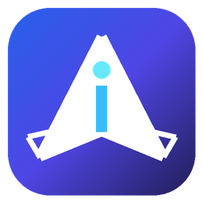

<p align="center">
  
</p>

<h1 align="center">JobPilot v5.1.0</h1>

<p align="center">
  <strong>智能求职副驾 · 全流程多平台自动化求职系统</strong>
</p>

<p align="center">
  <a href="https://github.com/zhangyuge258/jobpilot/stargazers"></a>
  <a href="https://github.com/zhangyuge258/jobpilot"></a>
  <a href="https://www.python.org/"></a>
  <a href="https://github.com/zhangyuge258/jobpilot/issues"></a>
  <a href="https://github.com/zhangyuge258/jobpilot/commits/main"></a>
</p>

<p align="center">
  🚀 本地运行 · 🔒 人工确认 · 🤖 多模型兼容 · 🧭 Chrome 自动化 · 🎯 定向直投
</p>

<p align="center">
  ⭐ 如果 JobPilot 对你有帮助，欢迎 <a href="https://github.com/zhangyuge258/jobpilot/stargazers"><strong>Star 本项目</strong></a> 支持持续迭代！
</p>

---

## 📖 项目简介

**JobPilot** 是一款专为求职者打造的智能求职辅助系统，旨在减少重复搜索、筛选和沟通准备的时间损耗，把最终投递决定权完全留给求职者本人。

系统采用现代化的 **曜青石墨蓝 + 象牙冷钛白** 视觉设计，具备多平台岗位聚合、AI 智能 JD 匹配评分、定向直投、个性化定制招呼语生成、保守合规投递及 HR 回复自动监测等完整功能流水线。所有投递操作均必须经过人工确认，绝不在未经确认时擅自发送。

[快速上手指南](docs/QUICKSTART.md) · [命令行操作说明](docs/CLI.md) · [提出建议或反馈问题](https://github.com/zhangyuge258/jobpilot/issues)

> [!WARNING]
> 自动化操作招聘平台存在账号限制或风控风险。本项目仅供学习、研究和个人求职效率提升使用；请严格遵守各平台服务条款与规则，保持低频合规操作，并自行承担使用风险。本项目与任何招聘平台及其关联公司不存在隶属、合作或背书关系。

---

## ✨ 核心特性

| 功能模块 | 说明 |
|---|---|
| 🌐 **多平台岗位池** | 本地 Web 工作台按平台独立采集 BOSS 直聘、智联招聘、前程无忧 51job、猎聘，支持跨平台去重与独立进度控制 |
| 🎯 **定向直投 (Direct Select)** | 针对重点企业与优质岗位的专属直通投递通道，支持精准定向匹配与策略跟进 |
| 🤖 **AI 深度评分** | 关键词初筛 + 大模型语义匹配，深度分析职位 JD 与个人简历画像的匹配度与技术要求 |
| 🔒 **人工双重确认** | 严格秉承“安全第一”，所有投递必须经过求职者显式确认，支持单岗位精细审核与批量确认 |
| 💬 **智能定制招呼语** | 根据具体岗位职责与求职者背景亮点，动态准备高质量、真诚不生硬的沟通用语 |
| 🛡️ **保守风控发送** | 拟人化随机间隔、投递时间窗口约束、每日额度上限管控以及发送前页面安全校验 |
| 📊 **求职驾驶舱与监测** | 可视化仪表盘实时呈现投递进展、HR 回复状态追踪与数据统计分析 |
| 📄 **定制简历适配** | 针对 HR 索取简历场景，结合目标岗位 JD 辅助生成更契合的定制化求职材料 |

### 平台支持矩阵

| 平台 | 采集与 AI 分析 | 投递与会话跟进 |
|---|---|---|
| **BOSS 直聘** | ✅ 深度采集与语义评分 | ✅ 人工确认后低频发送，支持回复监听 |
| **智联招聘** | ✅ 只读采集、评分与招呼语准备 | 🖱️ 引导在原平台手动投递，回填状态 |
| **前程无忧 51job** | ✅ 只读采集、评分与招呼语准备 | 🖱️ 引导在原平台手动投递，回填状态 |
| **猎聘** | ✅ 只读采集、评分与招呼语准备 | 🖱️ 引导在原平台手动投递，回填状态 |

---

## 🚀 快速开始

### 运行环境要求
* Python 3.10+
* Node.js 18+ (推荐 Node.js 20+)
* Google Chrome 浏览器 (已安装并支持调试模式)
* 可选的 AI 模型 API Key (支持 Anthropic Claude, OpenAI 兼容接口等多家服务商)

### 安装与启动

1. **克隆项目到本地**：
   ```bash
   git clone https://github.com/zhangyuge258/jobpilot.git
   cd jobpilot
   ```

2. **安装并构建前端**：
   ```bash
   cd src/bosshunter/web/frontend
   npm install
   npm run build
   cd ../../../..
   ```

3. **配置 Python 虚拟环境并安装依赖**：
   ```bash
   python -m venv .venv
   # Windows:
   .\.venv\Scripts\activate
   # Linux/macOS:
   # source .venv/bin/activate

   pip install -e .
   ```

4. **启动 JobPilot 本地求职工作台**：
   ```bash
   jobpilot web
   ```
   * 启动后在浏览器打开 `http://127.0.0.1:8686`，即可进入求职驾驶舱。
   * API Key 仅保存在您本地，绝不会上传到任何外部服务器或公开仓库。

---

## 📚 详细文档导航

* [快速上手指南 (QUICKSTART.md)](docs/QUICKSTART.md) — 详细的 Chrome 连接、环境准备与首次配置指南
* [CLI 命令行手册 (CLI.md)](docs/CLI.md) — 常用终端命令、分步运行与状态检查
* [配置参数详解 (CONFIGURATION.md)](docs/CONFIGURATION.md) — 岗位过滤条件、黑名单公司与风控参数
* [常见问题解答 (FAQ.md)](docs/FAQ.md) — 常见连接问题与平台风控注意事项
* [Windows 一键启动指南 (windows-launcher.md)](docs/windows-launcher.md) — 桌面图标与一键调试启动器设置

---

## 📄 开源许可证

本项目源码采用 [PolyForm Noncommercial License 1.0.0](LICENSE) 进行保护，仅允许非商业用途的学习、研究和个人求职使用。未经授权禁止用于任何商业营利场景。
